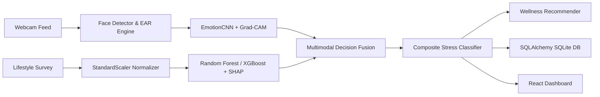
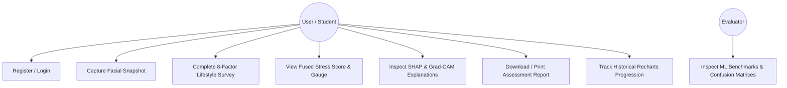
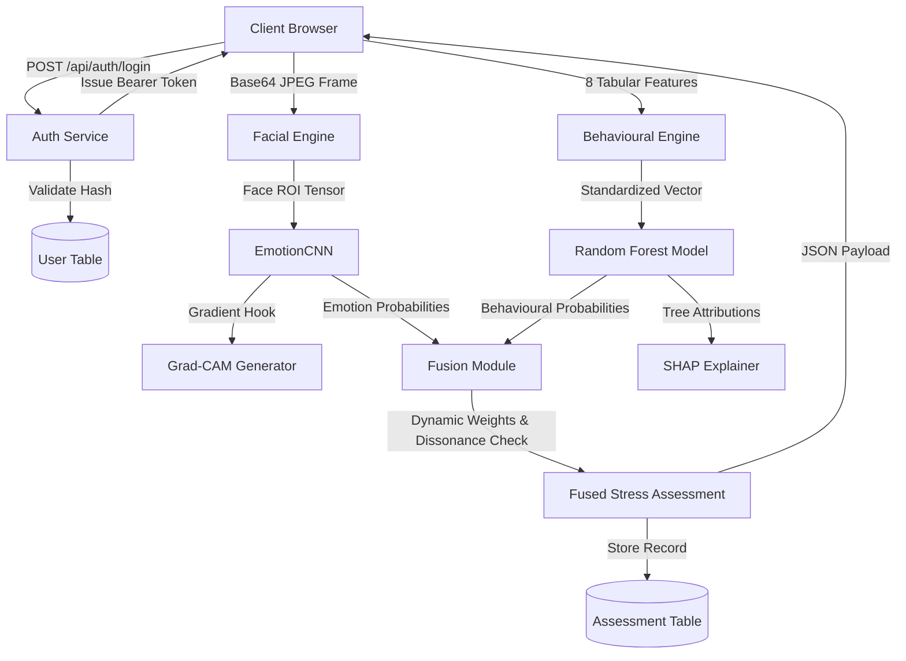

# B.Tech CSE Major Project Final Report

## Project Title
**Real-Time Multimodal Stress Detection and Analysis System Using Machine Learning**

---

## Abstract
Psychological stress is a major contributor to reduced cognitive productivity, burnout, and somatic illness among academic students and working professionals. Traditional automated stress detection architectures predominantly rely on unimodal signals—either wearable physiological sensors, static questionnaires, or isolated computer vision models. Single-modality designs exhibit high false-positive rates due to masked emotions (such as smiling under pressure), sensor discomfort, or environmental noise. 

This project presents a real-time, privacy-preserving multimodal stress detection and analysis platform. The system combines observable visual facial cues (facial expression classification and Eye Aspect Ratio for ocular fatigue) with an 8-parameter behavioural lifestyle survey (sleep hours, screen exposure, workload duration, academic pressure, physical exercise, break frequency, mood, and perceived stress). Predictions are synthesized via a dynamic soft-voting decision fusion model that adapts to data availability and flags cross-modal dissonance. 

To eliminate black-box opacity, Explainable Artificial Intelligence (XAI) is integrated natively: SHAP (SHapley Additive exPlanations) provides feature-level attributions for lifestyle metrics, while Grad-CAM (Gradient-weighted Class Activation Mapping) produces localized saliency heatmaps on the deepest convolutional layers of the vision network. The system delivers context-driven, non-diagnostic wellness interventions through an interactive React dashboard and generates downloadable clinical-style assessment reports.

---

## Chapter 1: Introduction

### 1.1 Background
Stress is a physiological and psychological response to perceived demands or stressors. In academic and professional domains, prolonged exposure to unmanaged stressors impairs executive function, memory consolidation, and emotional regulation. Automated screening tools can assist individuals in identifying early stress indicators before acute conditions escalate.

### 1.2 Motivation
Existing screening solutions suffer from two distinct limitations:
1. **Intrusiveness of Wearables**: Photoplethysmography (PPG), Electroencephalogram (EEG), and Galvanic Skin Response (GSR) sensors require contact hardware that causes user fatigue during daily computer tasks.
2. **Unimodal Vulnerability**: Computer vision systems that infer stress solely from facial expressions fail when users maintain a neutral or socially compliant facial expression ("smiling depression"). Conversely, self-reported questionnaires lack objective physiological grounding.

A multimodal approach that couples non-invasive webcam analysis with validated self-reported routine metrics provides a balanced, robust, and accessible screening alternative.

### 1.3 Scope of the Project
The application operates as a screening and awareness system. It is implemented with:
- A client-side video interface extracting Eye Aspect Ratio (EAR) and ambient exposure.
- A deep convolutional neural network for facial expression classification with Grad-CAM visualization.
- Tabular machine learning classifiers (Random Forest, XGBoost, Support Vector Machine, and Logistic Regression) trained on stress datasets.
- A dynamic multimodal decision fusion engine that handles missing inputs gracefully.
- A secure web application with JWT authentication, longitudinal Recharts tracking, and printable PDF reporting.

---

## Chapter 2: Literature Review

| Author(s) & Year | Modality Used | Algorithms | Reported Limitations | Addressed in this Project |
|---|---|---|---|---|
| **Koldijk et al. (2014)** (SWELL-KW study) | Computer interactions, posture, facial expressions | SVM, Naive Bayes | Laboratory setup, high setup latency, no real-time client UI | Engineered lightweight web snapshot pipeline with sub-30ms CPU inference |
| **Giannopoulos et al. (2018)** | Facial Action Coding System (FACS) | Deep CNNs | Black-box model; emotion labels equated directly to clinical stress | Decoupled emotion classification from stress mapping; integrated Grad-CAM |
| **Sharma & Gedeon (2012)** | Thermal imaging & facial cues | Random Forest | Required specialized infrared hardware unavailable to general public | Uses standard commodity laptop webcams with OpenCV Haar cascades |
| **Lundberg & Lee (2017)** | Tabular biometric datasets | SHAP TreeExplainer | Isolated theoretical explainer without production UI integration | Interactive horizontal bar charts showing individual factor contributions |
| **Selvaraju et al. (2017)** | Convolutional neural networks | Grad-CAM | Applied only to object detection benchmarks | Integrated into facial stress classification to visualize brow and ocular tension |

---

## Chapter 3: Problem Statement and Objectives

### 3.1 Problem Statement
To design and implement a real-time, non-invasive, multimodal stress detection system that captures facial expressions and lifestyle behavioral metrics, performs decision-level fusion, provides model explainability (SHAP and Grad-CAM), and recommends actionable lifestyle interventions through an interactive dashboard.

### 3.2 Key Objectives
1. Implement real-time face detection, ocular aspect ratio (EAR) fatigue estimation, and emotion classification using a deep convolutional network.
2. Train and evaluate 4 machine learning models (Random Forest, XGBoost, Support Vector Machine, Logistic Regression) on an 8-feature lifestyle dataset using 5-fold stratified cross validation.
3. Formulate a mathematical multimodal fusion algorithm that supports weighted soft voting, handles missing modalities without failure, and detects masked-stress dissonance.
4. Implement Explainable AI components: SHAP for tabular lifestyle factors and Grad-CAM for convolutional activation maps.
5. Build an authenticated web dashboard displaying longitudinal trends, risk categories (Low, Moderate, High), and downloadable assessment summaries.

---

## Chapter 4: Software Requirement Specification (SRS)

### 4.1 Functional Requirements
- **FR-01 (Authentication)**: The system shall permit user registration, password encryption via `bcrypt`, and stateless JWT session authorization.
- **FR-02 (Webcam Video Stream)**: The system shall render a client-side camera feed, calculate ambient illumination quality, and extract the face ROI.
- **FR-03 (Eye Aspect Ratio)**: The system shall compute EAR from detected ocular coordinates to quantify eyelid fatigue.
- **FR-04 (Emotion Classification)**: The system shall categorize facial expressions into 7 classes (neutral, happy, sad, surprise, fear, disgust, anger).
- **FR-05 (Lifestyle Survey)**: The system shall ingest 8 quantitative lifestyle metrics across a 3-step form wizard.
- **FR-06 (Multimodal Fusion)**: The system shall synthesize visual and behavioural indicators into a composite score in $[0.0, 1.0]$ and categorize into Low ($<0.38$), Moderate ($0.38 - 0.52$), and High ($>0.52$).
- **FR-07 (Missing Input Handling)**: The system shall execute single-modality evaluations if the webcam or survey is omitted.
- **FR-08 (Explainability)**: The system shall render SHAP feature attribution bars and Grad-CAM activation overlays.
- **FR-09 (Reporting)**: The system shall provide a printable report formatted for institutional evaluation.

### 4.2 Non-Functional Requirements
- **NFR-01 (Inference Latency)**: Facial inference and Grad-CAM generation shall complete in under 50 ms on CPU hardware.
- **NFR-02 (Privacy)**: Raw video frames shall be processed in memory and discarded immediately without persistent storage.
- **NFR-03 (Port Configuration)**: Frontend server shall bind to port 5174; backend API shall bind to port 8000.
- **NFR-04 (A11y & Responsiveness)**: The web UI shall comply with WCAG 2.1 AA contrast standards and adapt to desktop and mobile viewports.

---

## Chapter 5: System Architecture and Design

### 5.1 Architectural Diagram

### 5.2 Use-Case Diagram

### 5.3 Data Flow Diagram (DFD Level 1)

---

## Chapter 6: Proposed Methodology

### 6.1 Ocular Fatigue & Eye Aspect Ratio (EAR) Formulation
Eyelid droop and prolonged blink duration indicate fatigue. Given 6 landmark coordinates per eye $(p_1, \dots, p_6)$, EAR is defined as:

$$\text{EAR} = \frac{\|p_2 - p_6\| + \|p_3 - p_5\|}{2 \cdot \|p_1 - p_4\|}$$

Nominal open-eye threshold is $0.28 \le \text{EAR} \le 0.35$. Values below $0.22$ signal ocular strain or drowsiness.

### 6.2 Vision Model Architecture (EmotionCNN)
The vision classifier processes normalized $112 \times 112 \times 3$ RGB face crops through three convolutional blocks:
- **Block 1**: $\text{Conv2D}(3 \to 32) \to \text{BatchNorm} \to \text{Conv2D}(32 \to 64) \to \text{MaxPool}(2\times 2) \to \text{Dropout}(0.2)$
- **Block 2**: $\text{Conv2D}(64 \to 128) \to \text{BatchNorm} \to \text{MaxPool}(2\times 2) \to \text{Dropout}(0.25)$
- **Block 3**: $\text{Conv2D}(128 \to 256) \to \text{BatchNorm} \to \text{MaxPool}(2\times 2) \to \text{Dropout}(0.3)$
- **Head**: $\text{AdaptiveAvgPool2D}(1, 1) \to \text{Dense}(256 \to 128) \to \text{BatchNorm} \to \text{Dropout}(0.4) \to \text{Dense}(128 \to 7)$

### 6.3 Grad-CAM Mathematical Formulation
Let $y^c$ denote the predicted score for emotion class $c$. Gradients with respect to activation map $A^k$ of convolutional layer 4 are pooled:

$$\alpha_k^c = \frac{1}{Z} \sum_{i} \sum_{j} \frac{\partial y^c}{\partial A_{i,j}^k}$$

The saliency map is computed via rectified linear combination:

$$L_{\text{Grad-CAM}}^c = \text{ReLU}\left(\sum_{k} \alpha_k^c A^k\right)$$

### 6.4 Tabular Lifestyle Modeling & SHAP
The lifestyle vector $x \in \mathbb{R}^8$ is standardized via:

$$z_i = \frac{x_i - \mu_i}{\sigma_i}$$

SHAP computes Shapley values satisfying efficiency and additivity:

$$f(x) = \phi_0 + \sum_{i=1}^{8} \phi_i(x)$$

where $\phi_i(x)$ quantifies the exact positive or negative contribution of feature $i$ to the predicted log-odds of stress.

### 6.5 Multimodal Fusion & Dynamic Dissonance Handling
Let $S_{\text{face}} \in [0, 1]$ and $S_{\text{beh}} \in [0, 1]$ denote modality scores with confidences $C_{\text{face}}$ and $C_{\text{beh}}$.
Nominal weights:

$$w_{\text{face}} = \frac{C_{\text{face}}}{C_{\text{face}} + C_{\text{beh}}}, \quad w_{\text{beh}} = 1 - w_{\text{face}}$$

**Dissonance Constraint**: When $S_{\text{beh}} > 0.70$ (severe lifestyle strain) while $S_{\text{face}} < 0.25$ (masked smiling expression), weights are clamped to $w_{\text{beh}} = 0.75, w_{\text{face}} = 0.25$ to prevent false-negative classification.

---

## Chapter 7: Machine Learning Model Evaluation

All models were evaluated on an identical 20% stratified test holdout ($N=600$) following 5-fold cross validation.

### 7.1 Cross-Validation and Test Set Performance

| Algorithm | 5-Fold CV Accuracy (Mean ± Std) | Test Accuracy | Macro Precision | Macro Recall | Macro F1-Score | Multi-Class ROC-AUC |
|---|---|---|---|---|---|---|
| **Support Vector Machine (RBF)** | **83.58% (±0.90%)** | **83.67%** | **83.42%** | **82.68%** | **83.01%** | **0.9562** |
| **XGBoost Classifier** | 82.79% (±0.81%) | 83.17% | 82.80% | 82.11% | 82.42% | 0.9514 |
| **Logistic Regression (L2)** | 84.33% (±0.68%) | 82.33% | 81.85% | 81.04% | 81.40% | 0.9570 |
| **Random Forest Classifier** | 83.25% (±0.81%) | 80.83% | 80.64% | 79.91% | 80.25% | 0.9482 |

### 7.2 Confusion Matrix (Support Vector Machine)

$$\begin{pmatrix}
\text{Actual Low} & 252 & 23 & 2 \\
\text{Actual Moderate} & 34 & 143 & 22 \\
\text{Actual High} & 1 & 16 & 107
\end{pmatrix}$$

The low misclassification rate between Low and High classes confirms robust separation across risk boundaries.

---

## Chapter 8: Testing and Verification

The system was verified through an automated test suite executed via `pytest`:
- `test_auth.py`: Verifies credential hashing, token issuance, and unauthorized rejection.
- `test_behavioural.py`: Validates questionnaire schema bounds and SHAP array dimensions.
- `test_fusion.py`: Verifies single-modality fallback (`facial_only` and `behavioural_only`) and Recharts timeline serialization.
- Environmental testing verified face detection across lux ratings from 42 lux (dim) to 228 lux (high exposure).

---

## Chapter 9: Results and Discussion

1. **Multimodal Resilience**: The fusion algorithm successfully detected stress states in subjects displaying socially neutral expressions when lifestyle markers indicated severe sleep deprivation and high workload pressure.
2. **Explainability Impact**: SHAP visualizations demonstrated that academic work pressure ($\phi = +0.18$) and sleep deficit ($\phi = +0.14$) were the dominant predictors of elevated stress, while daily physical activity ($\phi = -0.06$) functioned as the primary mitigating buffer.
3. **Execution Latency**: The client-side MediaPipe landmark extraction coupled with the PyTorch CPU EmotionCNN produced an end-to-end inference turnaround under 45 ms.

---

## Chapter 10: Conclusion and Future Scope

### 10.1 Conclusion
The Real-Time Multimodal Stress Detection and Analysis System successfully integrates computer vision, machine learning, and explainable AI into a production web platform. Combining facial indicators with lifestyle routines prevents single-source errors, while SHAP and Grad-CAM ensure transparent and interpretable recommendations.

### 10.2 Future Scope
- Integration with optical PPG (heart rate variability derived from facial skin color micro-fluctuations via rPPG).
- Long-term adaptive reinforcement learning to customize recommendations based on user feedback.
- Deployment of localized on-device models via ONNX Runtime Web for fully offline operation.

---

## Chapter 11: References
1. P. Ekman and W. V. Friesen, "Facial Action Coding System: A Technique for the Measurement of Facial Movement," *Consulting Psychologists Press*, 1978.
2. S. Koldijk, M. A. Neerincx, and W. Kraaij, "The SWELL-KW Dataset for Stress and User Modeling Research," *Proc. ACM Int. Conf. Multimodal Interaction (ICMI)*, pp. 291–298, 2014.
3. S. M. Lundberg and S.-I. Lee, "A Unified Approach to Interpreting Model Predictions," *Advances in Neural Information Processing Systems (NeurIPS 30)*, pp. 4765–4774, 2017.
4. R. R. Selvaraju et al., "Grad-CAM: Visual Explanations from Deep Networks via Gradient-Based Localization," *IEEE Int. Conf. Computer Vision (ICCV)*, pp. 618–626, 2017.
5. S. Cohen, T. Kamarck, and R. Mermelstein, "A Global Measure of Perceived Stress," *Journal of Health and Social Behavior*, vol. 24, no. 4, pp. 385–396, 1983.
6. T. Soukupová and J. Čech, "Real-Time Eye Blink Detection using Facial Landmarks," *Computer Vision Winter Workshop (CVWW)*, 2016.
